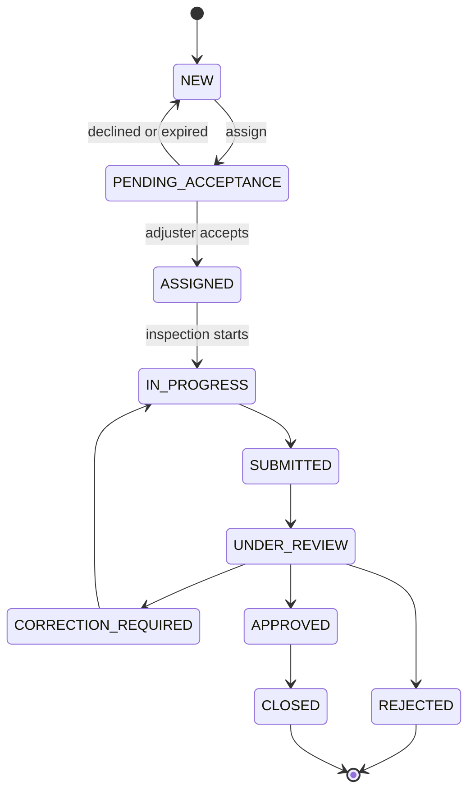

# Sawn | صون

**Backend API for a multi-tenant motor insurance claims platform, built for Palestinian insurers.**
Formerly InsurFlow. 4th place, Startup MVP Bootcamp.


[Live dashboard](https://insurflow-dashboard.vercel.app/) · [Frontend repo](https://github.com/InsurFlow-Team/insurflow-frontend)

---

## The problem

A car insurance claim passes through many hands: the officer who opens the file, the field adjuster who inspects the car, and the reviewer who approves or rejects the payout.

Sawn puts the whole claim in one system. Several insurance companies share the platform, so three rules matter most:

1. Each company sees only its own claims.
2. A claim moves through its steps in order, with no skipped steps.
3. Two claims filed at the same moment never get the same number.

## What the system does

- Opens a claim and checks the policy before the file starts.
- Sends the claim to a field adjuster on a map, based on distance and current workload.
- Lets the adjuster record the vehicle, the accident, photos and a digital signature from a mobile app.
- Moves the claim through review, approval or rejection, with a full history of every step.
- Handles repair estimates, repair orders, discharge forms, payments and reserves.
- Produces PDF reports and letters in Arabic.
- Gives the customer a public link to follow the claim without logging in.
- Sends push notifications to the mobile app.

## Who uses it

| Role | Main job |
|------|----------|
| Admin | Manages users inside the company and closes claims |
| Claims Officer | Opens, assigns, reviews and decides claims |
| Field Adjuster | Accepts tasks and inspects the vehicle on site |

## Claim lifecycle

Every claim follows these steps. The API rejects any move outside this path with `409 INVALID_STATUS_TRANSITION`.



## Engineering highlights

- **Tenant isolation.** `organizationId` comes from the verified JWT, never from the request body. Access to another company's record returns `404`, so IDs cannot be probed.
- **Atomic state changes.** One `findOneAndUpdate` checks tenant, expected status and owner in the same query. Two users acting at once cannot both win.
- **Safe claim numbers.** Each company gets its own sequence (`CLM-<ORG>-0001`) from an atomic counter.
- **Workload cap.** An adjuster holds at most 3 active claims.
- **Audit trail.** Every status change writes a timeline event: who, role, previous status, new status, time and notes.
- **Tested.** 65 Jest test suites with 1,300+ test cases run against an in-memory MongoDB.
- **Hardened.** Helmet, configurable CORS origins, rate limits on login, the API and the public tracking route.

## Tech stack

| Area | Tools |
|------|-------|
| Runtime and API | Node.js, Express 5 |
| Database | MongoDB, Mongoose 9 |
| Validation and auth | Joi, JWT, bcrypt |
| Files and push | Cloudinary, Firebase Cloud Messaging |
| PDF | pdfmake-rtl (Arabic support) |
| Testing | Jest, Supertest, mongodb-memory-server |

**Size:** 11 modules, 70 endpoints under `/api/v1`.

## Project structure

```text
src/
├── modules/        # auth, users, organizations, incidents, claims, vehicles,
│                   # policies, customers, garages, letters, notifications
├── middlewares/    # auth, roles, validation, uploads, rate limits, errors
├── services/       # push notifications
├── utils/          # money, dates, masking, responses
└── scripts/demo/   # demo data seeding
tests/              # Jest + Supertest suites
```

Each module holds its own `routes`, `controller`, `service`, `repository`, `model` and `validation` files.

## Run locally

```bash
git clone https://github.com/InsurFlow-Team/insurflow-backend.git
cd insurflow-backend
npm install
cp .env.example .env    # fill in MongoDB, JWT and Cloudinary values
npm run dev
```

| Command | Purpose |
|---------|---------|
| `npm test` | Run the full test suite |
| `npm run seed:demo` | Load demo data |
| `npm run seed:demo:reset` | Reset and reload demo data |

The API contract lives in the code: each module defines its endpoints in `<module>.routes.js` and its request rules in `<module>.validation.js`. A Postman collection is included: `InsurFlow.postman_collection.json`.

## Team

Built by a team of four: 2 frontend, 1 mobile and 1 backend developer.

**Backend:** [Mohammed Ferwana](https://github.com/hammoudFerwana), co-founder and sole backend developer.
[LinkedIn](https://www.linkedin.com/in/mohammed-ferwana) · mohammedferwana2@gmail.com
